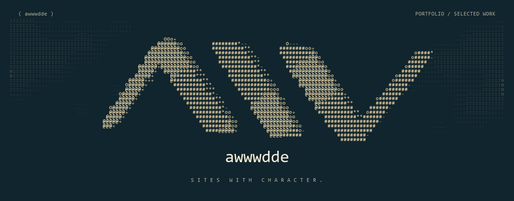

  <a href="https://awwwdde.art">
    <picture>
      <source media="(prefers-reduced-motion: reduce)" srcset="docs/readme/ascii-cover.png">
      
    </picture>
  </a>

<h1 align="center">Сайты с характером.</h1>

От идеи до запуска. Дизайн, движение и внимание к деталям.

  <a href="https://awwwdde.art">Открыть сайт ↗</a>
  &nbsp; · &nbsp;
  <a href="https://awwwdde.art/work">Проекты</a>
  &nbsp; · &nbsp;
  <a href="https://awwwdde.art/about">Обо мне</a>
  &nbsp; · &nbsp;
  <a href="https://awwwdde.art/contact">Связаться</a>

---

**awwwdde** — личное портфолио Владислава, дизайнера и разработчика.
Здесь собраны работы, визуальные эксперименты и идеи, которые стали сайтами.

Облака из символов, объёмные формы, плавное движение и маленькие пасхалки
создают настроение. При этом в центре остаются проекты: что нужно было
сделать, как нашлось решение и что получилось в итоге.

Это пространство для моего подхода к работе — продумать идею, найти её
визуальный характер и довести до работающего сайта. От первого наброска
до последней детали.

  <code>idea → design → experience</code>

  <a href="https://awwwdde.art/work">Посмотреть работы ↗</a>
  &nbsp; · &nbsp;
  <a href="mailto:message@awwwdde.art">message@awwwdde.art</a>

  <a href="docs/readme/ascii-cover.png">Статичная версия заставки</a>

